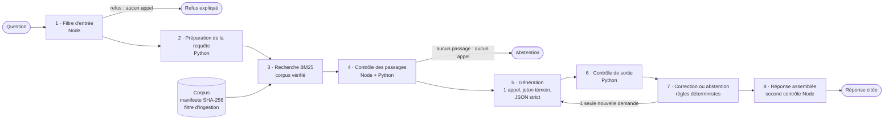

# Architecture du RAG documentaire et des résumés à agents

*18 novembre 2026.* Folio a deux parcours, construits différemment à dessein :

- **Le chat avec les documents est un RAG simple, sans agent.** Une chaîne fixe de huit étapes, des règles déterministes pour corriger les erreurs et la dérive, un seul appel au modèle par question (deux au plus quand la règle de correction s’applique).
- **Les résumés thématiques gardent leurs agents.** Quatre agents LangGraph (planificateur, chercheur, vérificateur, rédacteur) se passent le travail par transferts signés HMAC. Le chercheur peut compléter les rapports par des données de marché, via le serveur MCP Yahoo Finance.

La page **Sécurité** de l’application (05, réservée au propriétaire) montre cette architecture couche par couche, avec des compteurs réels, l’intégrité du corpus, les résultats de la suite d’attaques et un bac à sable qui applique les vrais filtres.

## Le chat : huit étapes fixes

| Couche | Où | Ce qu’elle arrête | Comment |
| --- | --- | --- | --- |
| 0 · Corpus vérifié | `corpus-integrity.mjs`, `rag-preparation.mjs` | empoisonnement du corpus, rapport modifié, saturation par doublons | Seuls les fichiers du manifeste `data/rag-data/manifest.json` (SHA-256) sont chargés ; le serveur refuse de démarrer sans manifeste. Doublons exacts exclus. Chaque fragment passe le filtre d’ingestion **avant** l’indexation : un fragment piégé n’entre ni dans l’index ni dans les statistiques BM25. Les fichiers servis sont revérifiés à l’exécution (taille, date, puis empreinte). |
| 1 · Filtre d’entrée | `rag-guards.mjs` (`screenQuestion`) | injection directe, jailbreak, extraction des consignes, demande de secret, exfiltration, contenu encodé, instruction fragmentée sur plusieurs messages, hors périmètre | Normalisation (invisibles, homoglyphes, leet, base64, hexadécimal, `%xx`, `\u`), règles en 8 langues (dont chinois, arabe et russe), classifieur local à partir de 8 mots, règles sur l’assemblage des trois derniers messages. Courriels, téléphones, IBAN et cartes masqués avant le modèle. Un refus n’appelle jamais le modèle. |
| 2 · Recherche bornée | `retrieval.mjs`, `app-store.mjs` | fuite entre comptes, saturation du contexte | Droits par entreprise appliqués avant la recherche ; 8 passages, 12 000 caractères ; 10-K privilégié pour une année sans trimestre. |
| 3 · Contrôle des passages | `rag-preparation.mjs`, `rag_pipeline.py` | injection indirecte, empoisonnement de mémoire | Second filtre serveur sur chaque passage, filtre Python indépendant, notes de mémoire examinées seules puis ensemble. Aucun passage admissible : abstention sans appel. |
| 4 · Génération encadrée | `rag_pipeline.py` | confusion consignes / données | Consignes fixes ; passages et notes dans le seul payload (avec leur `evidenceId`) ; historique de conversation jamais transmis ; jeton témoin propre à la question ; schéma JSON `{answerable, claims[]}`. |
| 5 · Contrôle de sortie | `rag_pipeline.py` (`validate_output`) | hallucination, dérive, exfiltration, fuite | Voir ci-dessous. |
| 6 · Correction | `rag_pipeline.py` (`run_rag`) | erreurs réparables | Règles ci-dessous. |
| 7 · Réponse assemblée | `ai-connector.mjs`, `rag-guards.mjs` (`guardClaims`) | sortie altérée, fuite du jeton témoin | Second contrôle de sortie, implémentation Node distincte de celle de Python ; la réponse et les citations sont construites par le code à partir des seules affirmations admises ; audit chaîné. |

### Contrôle de sortie (deux implémentations, mêmes règles)

**Rejet de toute la réponse :** jeton témoin recopié (même espacé), consignes recopiées (suite de 6 mots du prompt), motif de secret (`AIza…`, `sk-…`, `lsv2_…`, clé privée), balisage actif (`![`, `<script`, `<img`, `<iframe`, `javascript:`), instruction détectée par les règles, plus de 6 affirmations, champ hors schéma.

**Retrait d’une affirmation :** passage cité inconnu ; citation de moins de 12 caractères ou introuvable mot pour mot (seuls les espaces sont rétablis) ; année différente de celle du passage ; montant absent de la citation, comparé **en valeur et en unité** (`637 959`, `637,959` et `637.959` sont égaux, `3 910,35` ne l’est pas ; « milliards » contre un tableau en millions, un pourcentage absent de la citation, « 2 024 millions » ou des chiffres cerclés sont refusés ; une date comme « 31 décembre 2024 » n’est pas un montant ; une année isolée n’est admise que si elle est celle du passage, de la citation ou de la question) ; entreprise (des quatre du corpus ou d’une liste d’autres grandes entreprises) absente de la question, du passage et de la citation ; lien ou nom de domaine ; coordonnées ; doublon ; consigne d’une famille faible (mémoire, contrôles, fragments) ou texte jugé suspect par le classifieur.

Les questions précédentes servent à compléter une relance pour la **recherche** ; le modèle, lui, ne reçoit que la question posée et la ligne « Entreprises et périodes reprises », calculée par la règle. Une question précédente refusée par le filtre d’entrée n’est même pas transmise au worker.

### Règles de correction déterministes

1. Rejet de toute la réponse : rien n’est publié, aucune nouvelle demande (`OUTPUT_REJECTED`).
2. Au moins une affirmation admise : seules celles-ci sont publiées.
3. Aucune admise, le modèle pensait pouvoir répondre et tous les motifs sont réparables (citation, montant, année, passage inconnu) : **une** nouvelle demande, avec la liste des motifs et des nombres manquants. Même contrôle ensuite ; sinon abstention.
4. Le modèle indique que les passages ne répondent pas : abstention.
5. Aucun passage admissible après filtrage : abstention sans appel au modèle.

## Les résumés : agents et MCP

Planificateur → chercheur → vérificateur → rédacteur, chaque transfert scellé HMAC (rejeu, falsification, transition interdite refusés), politiques par rôle, budgets imposés par le serveur, middleware LangChain. Le rédacteur ne fait que choisir parmi des affirmations vérifiées.

**MCP Yahoo Finance.** Le planificateur peut proposer des tickers ; seuls AMZN, AAPL, GOOGL et META, et seulement pour une entreprise nommée dans le thème, sont retenus. Le chercheur demande l’outil `market_data` ; c’est le **serveur Node** qui parle au serveur MCP (`yahoo-finance-mcp-server==0.1.3`, JSON-RPC sur stdio, processus unique démarré en arrière-plan), jamais l’agent. La passerelle (`mcp-gateway.mjs`) n’autorise que deux outils en lecture seule, réduit la réponse à des champs listés (aucune adresse, aucun texte libre), la réécrit en lignes françaises, la passe au filtre d’injection, la garde 15 minutes en cache et ne transmet au processus MCP aucun secret. Les données de marché sont citées « Yahoo Finance (MCP) — ticker, consulté le … », séparément des rapports. Un appel pendant le démarrage du serveur MCP (25 à 130 s mesurés) renvoie « indisponible » sans bloquer le résumé.

Installation locale : `pip install uv`, puis `uv tool install yahoo-finance-mcp-server==0.1.3` ; le serveur Node le trouve dans `%USERPROFILE%\.local\bin` (ou `FOLIO_MCP_COMMAND`). `FOLIO_MCP=off` le désactive. En Docker, il est installé dans l’image depuis `docker/requirements-mcp.txt` (empreintes vérifiées, versions publiées depuis au moins deux semaines).

## Ce qui est mesuré

| Campagne | Attaques | Réussies | Cas légitimes | Faux positifs |
| --- | ---: | ---: | ---: | ---: |
| Hors ligne, toutes cibles (`node scripts/redteam.mjs`) | 165 | 0 | 170 | 0 |
| Réelle, Gemini 3.8 Flash (`--live --max-calls 24`) | 59 | 1 (1,7 %) | 8 | 1 |

La campagne réelle a été jouée avant la revue de sécurité indépendante ; les corrections de la revue rendent les contrôles plus stricts, jamais plus lâches, et la suite hors ligne a été rejouée après elles. Détail, méthode et l’attaque passée : [SECURITE-RAG-AGENTS-2026.md](SECURITE-RAG-AGENTS-2026.md) et [VALIDATION-2026-11.md](VALIDATION-2026-11.md).

## Limites

- La recherche reste lexicale (BM25) ; un passage pertinent mal classé mène à une abstention, pas à une réponse inventée.
- Le manifeste prouve qu’un fichier n’a pas changé depuis sa revue, pas qu’il est vrai. Un rapport piégé approuvé par erreur et qui passerait le filtre d’ingestion serait cité fidèlement : c’est le scénario de l’attaque passée de la campagne réelle.
- Les filtres réduisent le risque ; ils ne garantissent rien face à un attaquant adaptatif. Les règles de sortie, elles, sont strictes : elles préfèrent l’abstention à une réponse non vérifiable.
