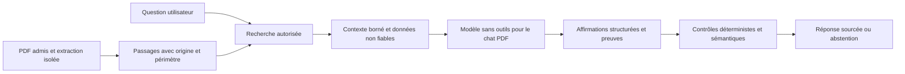

# Sécurité RAG et agents — Archive vivante

## Mise à jour du 13 novembre 2026

Le parcours actuel est décrit dans [BACKEND.md](BACKEND.md) : exécuteur Node/Python, Gemini, recherche BM25 automatique et graphe LangGraph borné. Le serveur conserve les permissions et budgets. Les citations exactes et années sources sont contrôlées ; un appel modèle vérifie leur cohérence avec les affirmations, avec des erreurs possibles. Les événements affichés proviennent du worker.

La nouvelle chaîne n’expose aucun outil shell, URL arbitraire ou fichier au modèle. Elle ne lance pas les outils Yahoo/MCP des notebooks. LangGraph ne constitue pas une sandbox système. Le fournisseur reçoit questions, passages et historique borné lors d’une analyse activée. Qdrant et l’authentification AWS restent à raccorder.

Les sections suivantes conservent le cadrage initial du **11 novembre 2026** ; les mentions « à raccorder » décrivent cet état antérieur. Les limites relatives aux injections, à la véracité et à l’absence d’isolation multi-utilisateur restent applicables.

## Ce qui fonctionne dans cette version

| Contrôle | Implémentation et limite |
| --- | --- |
| Périmètre documentaire explicite | Chaque session conserve jusqu’à huit identifiants connus. La préparation RAG recherche seulement dans ces documents. Ce choix n’est pas une ACL multi-utilisateur. |
| Préparation locale sans génération | `POST /api/threads/:id/rag-context` utilise le texte Markdown déjà extrait et une recherche lexicale BM25. Aucun fournisseur IA, téléchargement, shell ou outil externe n’est appelé sur ce parcours. |
| Contexte borné | Question de 4 000 caractères maximum, huit passages au plus, 1 800 caractères par passage et 12 000 au total. La mémoire est déjà bornée séparément. Ce sont des plafonds de caractères, pas de tokens. |
| Provenance | Identifiant de document, année, page quand disponible et empreinte SHA-256 du passage. Une empreinte permet de reconnaître un extrait ; elle ne prouve pas sa véracité ni l’authenticité de l’émetteur. |
| Instructions suspectes | Des règles locales repèrent certaines tentatives de changement de rôle, d’exfiltration ou d’exécution. Les passages et notes correspondants sont retirés des données préparées. Faux positifs et contournements restent possibles. |
| Données sans autorité | Les passages et notes portent explicitement une origine et une absence d’autorité d’instruction. Ce marquage est une préparation du contrat, pas une isolation formelle de type CaMeL. |
| Mémoire | Une instruction provenant d’un PDF n’est jamais automatiquement promue en mémoire durable. Les notes viennent des messages de l’utilisateur ou de son action « Retenir ». Elles restent considérées comme données non fiables pour le modèle. |
| Régression Python : données plutôt que code | La question financière passe au processus enfant par JSON sur l’entrée standard. Le programme Python exécuté est fixe, avec délai de 60 secondes et `shell=False`. Cela supprime l’interpolation dangereuse dans `python -c` ; le sous-agent Yahoo/MCP devra encore recevoir ses propres restrictions d’outils et de réseau. |
| Régression Python : chemins | Les fichiers d’agent doivent rester dans le répertoire utilisateur/session. Traversées, chemins absolus, flux Windows et liens sortant du périmètre sont rejetés. Cela ne remplace pas un conteneur, des permissions OS et une protection contre les courses de liens symboliques. |

Les messages, historiques, mémoires et sélections de PDF sont sauvegardés localement. Les réponses IA et citations de chat restent désactivées tant que le backend n’est pas connecté.

## Ce qui est préparé, sans exécution d’agents

`agent-policies.mjs` définit quatre rôles de raccordement : planificateur, chercheur documentaire, vérificateur et rédacteur. Le projet Python possède déjà une organisation orchestrateur / chercheurs par thème / éditeur ; le rôle de vérification constitue une séparation proposée à intégrer à ce parcours, et non un quatrième agent prétendument déjà actif.

La page de transparence présente les tâches, dépendances, livrables et outils prévus. Son journal est vide et ses états indiquent « prévu ». Aucun appel, durée ou résultat d’agent n’est simulé.

Le validateur `authorizeToolCall` contrôle le rôle, l’outil, les arguments, les documents, les références et les compteurs fournis par l’appelant. **Il doit être placé dans le véritable exécuteur d’outils Python/Node** avant toute activation. Le serveur devra conserver les budgets et permissions lui-même, sans accepter ceux du modèle. Les limites proposées sont douze appels d’outils et une profondeur de délégation ; elles ne s’appliquent pas encore à l’ancien graphe Python.

`verifyEvidenceClaims` rejette les références inconnues, les citations absentes du passage et certains décalages d’année. C’est un vérificateur déterministe testé mais non raccordé à une génération. Une citation présente ne suffit pas à démontrer que l’affirmation associée est vraie. La vérification sémantique, les unités, monnaies et périodes comptables restent à implémenter.

## Architecture recommandée pour le raccordement

Pour **Chat PDF**, commencer par ce RAG en lecture seule : aucune délégation, aucun outil de fichier, aucun MCP et aucun accès réseau du modèle. Un appel au fournisseur sera exécuté par le serveur avec ses secrets hors du contexte. Une question sans preuve suffisante doit recevoir une abstention explicite.

Pour les **résumés thématiques**, l’orchestrateur découpe les questions ; les chercheurs travaillent sur les documents admis ; la vérification filtre les preuves ; l’éditeur ne reçoit que les éléments admis. Chaque transfert conserve l’origine des données. Un résumé rédigé par un autre agent ne devient jamais une instruction privilégiée. Les réponses d’outils, mémoires et messages d’agents doivent garder leur niveau de confiance.

L’interface de transparence doit recevoir des événements structurés issus du serveur : tâche, rôle, statut, outil autorisé, début/fin, référence et résultat de contrôle. Ne pas journaliser les clés, les chaînes de pensée privées ou les mémoires brutes.

## Nouveautés et niveau de preuve au 11 novembre 2026

### Guide récent applicable : OWASP, 10 novembre 2026

Le guide **Securing Agentic Applications V2** couvre architecture, identité, accès, protections pendant l’exécution, chaîne d’approvisionnement et tests. Il constitue une base de revue actuelle pour ce projet ; sa publication ne certifie pas notre code. Voir le [guide OWASP V2](https://genai.owasp.org/resource/securing-agentic-applications-v2/) et le [Top 10 Agentic Applications 2026](https://genai.owasp.org/resource/owasp-top-10-for-agentic-applications-for-2026/).

### Recherche prometteuse : CaMeL et multi-CaMeL

CaMeL sépare flux de contrôle et données et impose des politiques de capacités lors des appels d’outils. C’est une défense d’architecture, avec un compromis d’utilité évalué sur AgentDojo. Source : [Defeating Prompt Injections by Design, version de juin 2025](https://arxiv.org/abs/2503.18813).

Le **préprint du 5 octobre 2026** montre que sécuriser chaque agent individuellement ne suffit pas : un agent suivant peut réinterpréter des données non fiables comme des instructions. Multi-CaMeL conserve la provenance et sépare les canaux de commande et de données. Les auteurs rapportent un taux de réussite des attaques de 0,0 % sur leur évaluation, contre 12,9 % sans CaMeL ; ces chiffres restent propres à leurs benchmarks et ne garantissent rien sur notre corpus. Source : [Can CaMeLs Talk?](https://arxiv.org/abs/2610.05640).

**Décision proposée pour MUTTI :** adopter d’abord les frontières de confiance et permissions explicites ; expérimenter ensuite ce protocole sur une branche dédiée avec des mesures d’utilité. Aucun composant CaMeL complet n’est installé dans cette version.

### Détecteurs : mesurer sur nos documents

Un **préprint du 2 octobre 2026** évalue quinze détecteurs et deux juges. Les classements se transfèrent mal d’un benchmark à l’autre et les faux positifs sur les sorties d’outils peuvent être très élevés. Un bon score public ne suffit donc pas à choisir un filtre de production. Source : [Passing the Test You Trained On](https://arxiv.org/abs/2610.03448).

**Décision proposée :** tester les filtres candidats sur nos rapports financiers, questions françaises et extraits anglais, en mesurant attaques bloquées, faux positifs et utilité. Le filtre local actuel est un premier contrôle explicite, pas une solution évaluée contre des attaquants adaptatifs.

### Outils disponibles, à ajouter selon le fournisseur

[Microsoft Prompt Shields](https://learn.microsoft.com/en-us/azure/foundry/openai/concepts/content-filter-prompt-shields) analyse les tentatives d’attaque dans les questions et documents. La documentation précise que ce contrôle ne vérifie ni provenance ni exactitude factuelle. Spotlighting est documenté comme protection supplémentaire en preview, avec contraintes d’API et coût de contexte. Ce choix dépend d’Azure ; il n’est pas nécessaire pour conserver l’architecture actuelle.

[NeMo Guardrails — Agentic Security](https://docs.nvidia.com/nemo/guardrails/configure-guardrails/guardrail-catalog/agentic-security) fournit notamment des règles de détection et des limites contre le gonflement du contexte. Ce sont des couches supplémentaires, à configurer et évaluer ; elles ne remplacent pas l’autorisation des outils.

[Microsoft PyRIT](https://github.com/microsoft/PyRIT) fournit un outillage de tests adversariaux automatisés et multi-tours. [AgentDojo](https://github.com/ethz-spylab/agentdojo) fournit un environnement de benchmark d’agents. Ils servent à éprouver le système ; ils ne protègent pas directement une requête en production. Aucun appel de test payant n’est lancé ici.

## Suite priorisée

1. Raccorder le modèle au chat PDF, sans outils, avec réponse structurée : affirmation, identifiant de preuve, citation exacte et incertitude. Ne publier les citations qu’après validation serveur.
2. Raccorder les événements réels du graphe Python à la transparence. Appliquer les permissions dans son exécuteur, avec identité injectée côté serveur, compteurs partagés, annulation, délais et quotas de tokens/coût.
3. Ajouter la vérification des périodes, unités, monnaies et calculs ; vérifier qu’une preuve implique bien l’affirmation. Refuser une conclusion insuffisamment étayée plutôt que compléter les lacunes.
4. Préparer une ingestion isolée avec limites de taille/type/pages, traitement des contenus cachés et images, provenance, contrôle des mises à jour et retrait d’un document empoisonné.
5. Avant tout hébergement partagé : authentification, ACL documentaires avant récupération, isolation des utilisateurs dans la base vectorielle et la mémoire, protection des fichiers et des secrets, sorties réseau restreintes, journal d’audit sans contenu sensible.
6. Exécuter des attaques adaptatives et multi-tours, y compris par document, mémoire et transfert entre agents. Comparer chaque protection à une base sur les mêmes tâches légitimes.

## Évaluation attendue

Les tests locaux couvrent le périmètre documentaire, les injections textuelles connues, la mémoire suspecte, les références inventées, les citations altérées, les périodes incohérentes, les permissions de rôle, les budgets fournis, l’interpolation Python et les traversées de chemins. Le test créant un lien symbolique est ignoré lorsque Windows refuse sa création.

À ajouter au raccordement : attaques encodées et multilingues, texte caché/OCR, empoisonnement de mémoire sur plusieurs tours, exfiltration indirecte par URL ou outil, fuites entre comptes, délégation circulaire, consommation excessive et contradictions comptables.

Mesurer séparément le taux de réussite d’attaque, le taux de faux positifs, la réussite des tâches légitimes, l’exactitude des citations, la qualité factuelle, la latence et le coût. Les tests unitaires présents ne constituent pas un benchmark adversarial du futur système génératif.
