# Captures avant / après — lot 3 (17 novembre 2026)

Captures prises avec Edge par Playwright sur l’application réelle : serveur isolé, données temporaires, modèle simulé pour le chat et le résumé. Les captures « avant » datent de l’état précédant le lot 3, aux mêmes largeurs (1 440 px et 390 px).

| Page | Avant | Après |
| --- | --- | --- |
| Connexion |  | 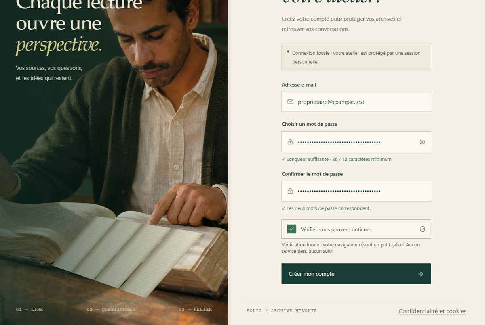 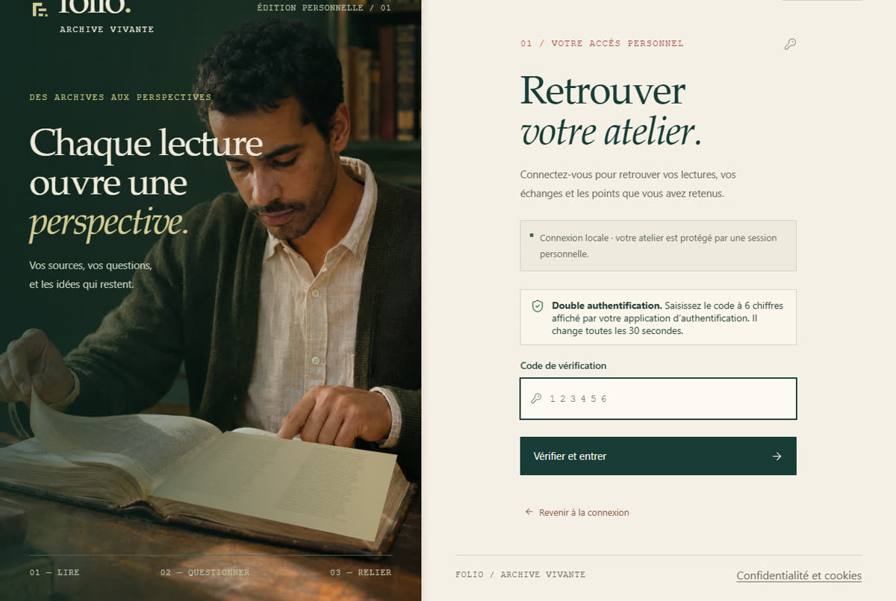 |
| Accueil | 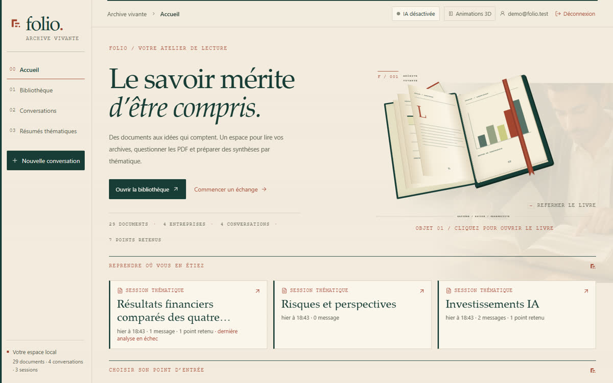 | 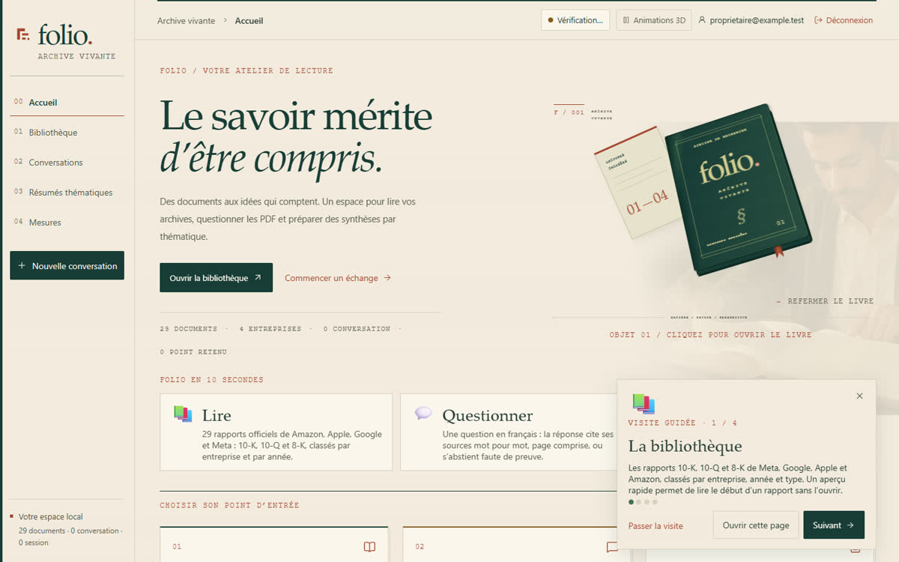 |
| Accueil, téléphone | 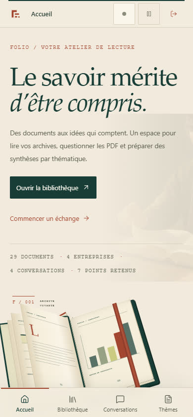 | 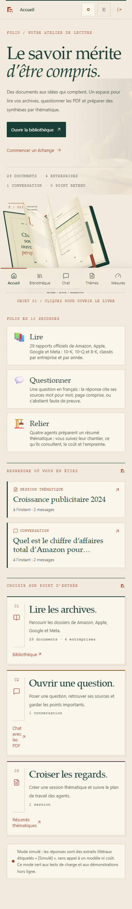 |
| Bibliothèque | 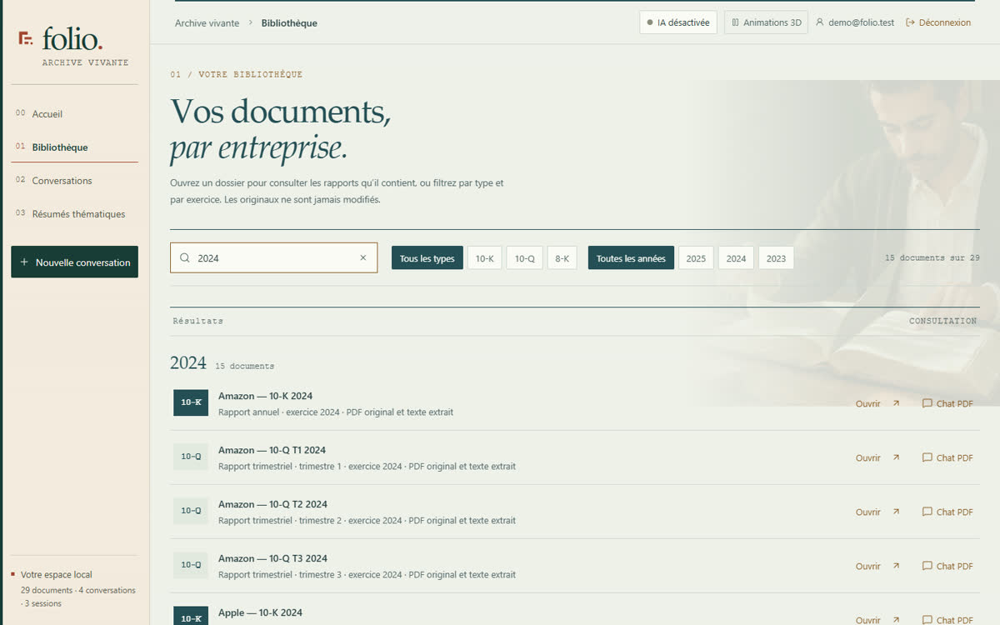 | 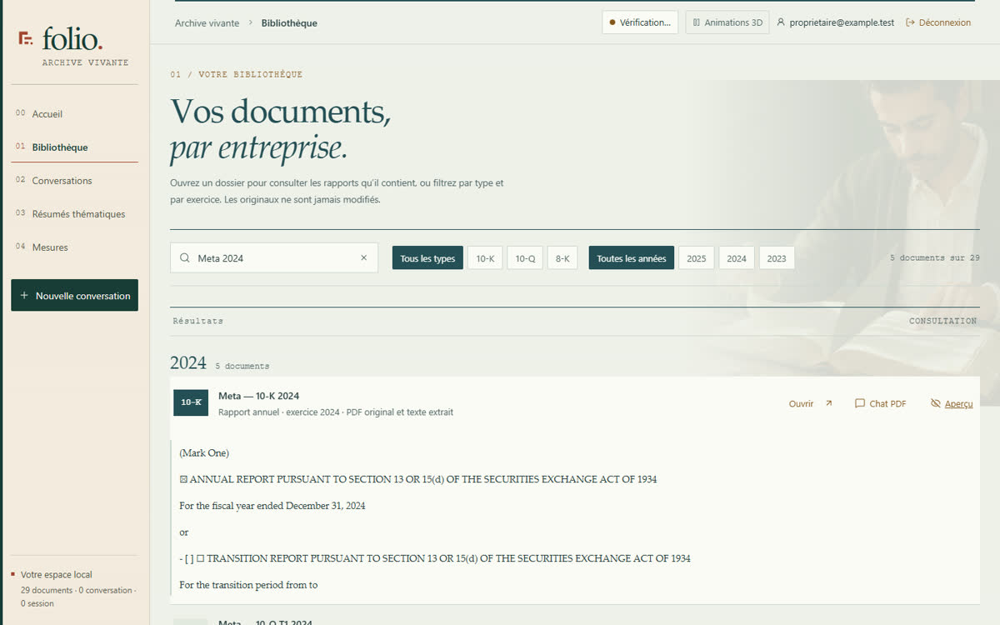 |
| Chat pendant l’analyse | 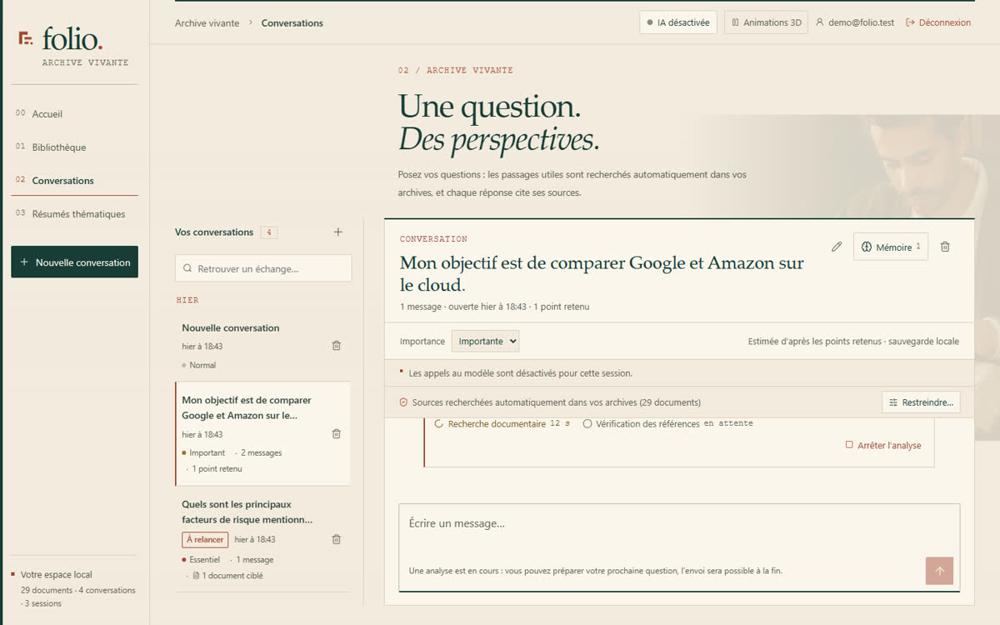 | 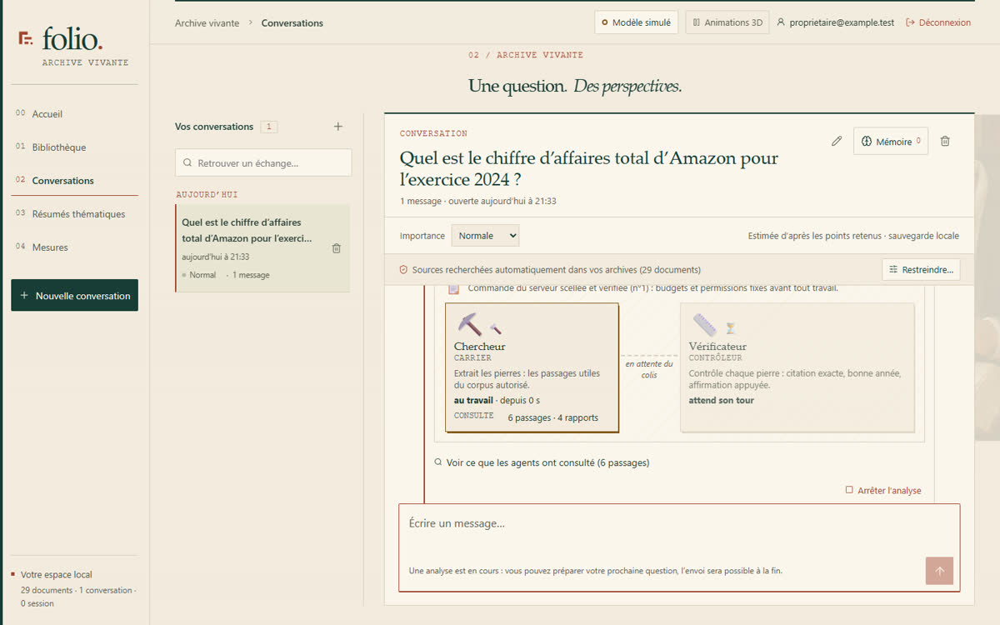 |
| Source ouverte à la page | — | 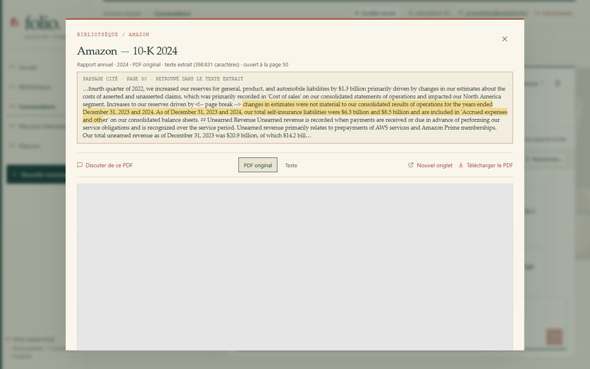 |
| Résumé thématique et transparence | 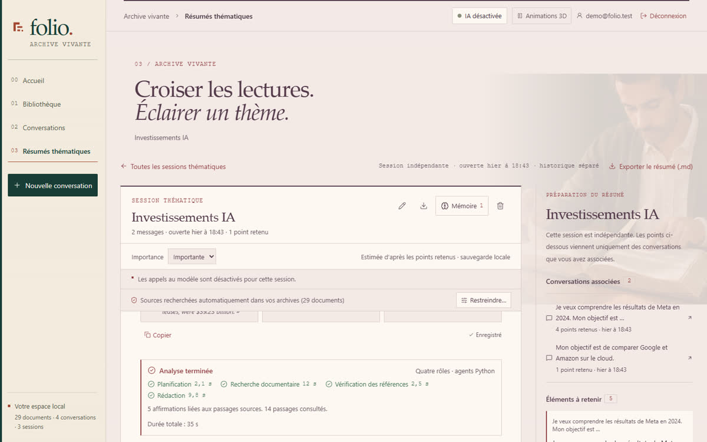 | 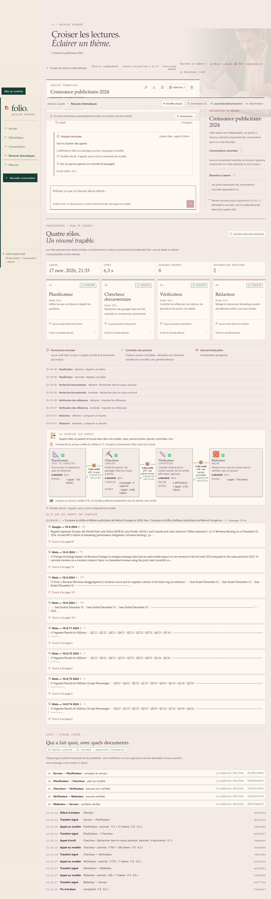 |
| Résumé, téléphone | — | 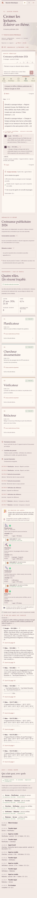 |
| Mesures | — | 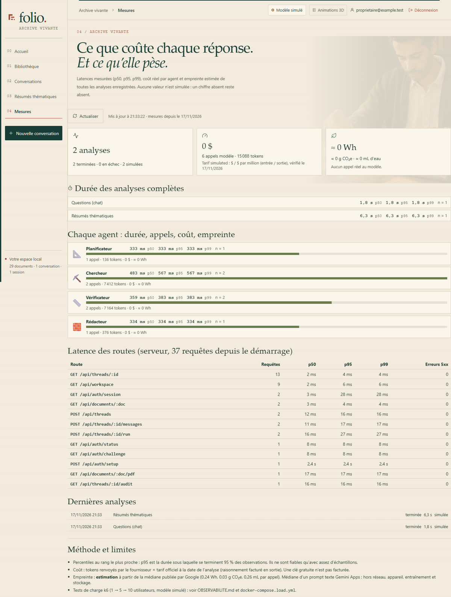 |
| Mon compte | — | 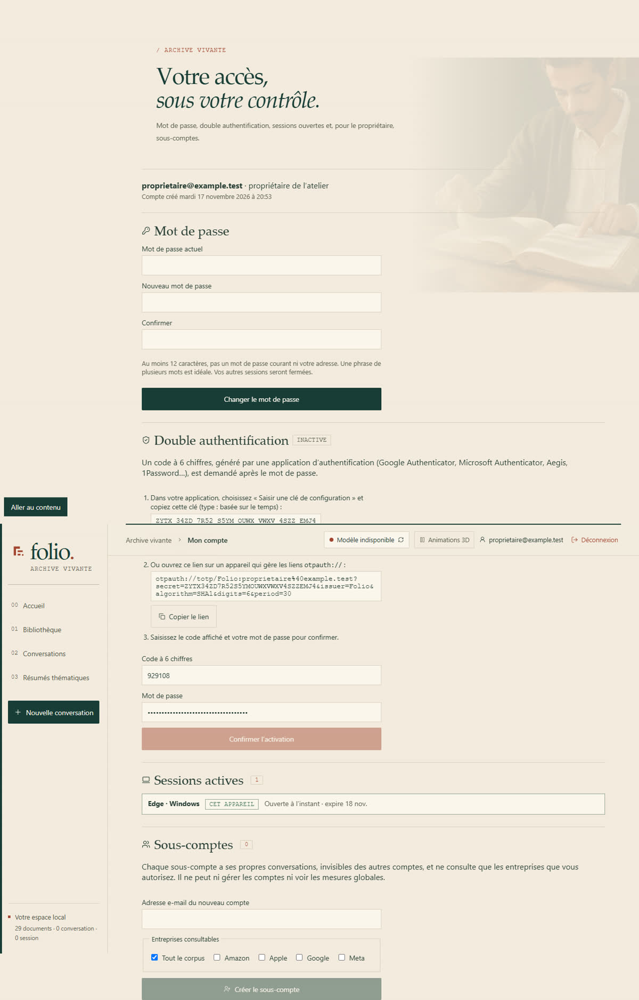 |
| Sous-compte invité, téléphone | — | 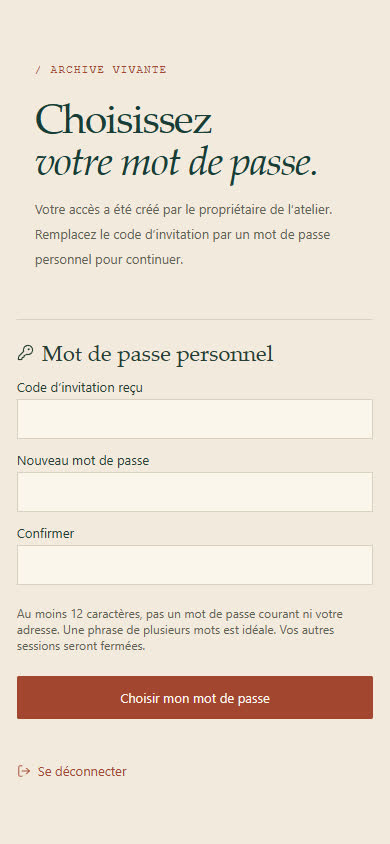 |
| Confidentialité | — | 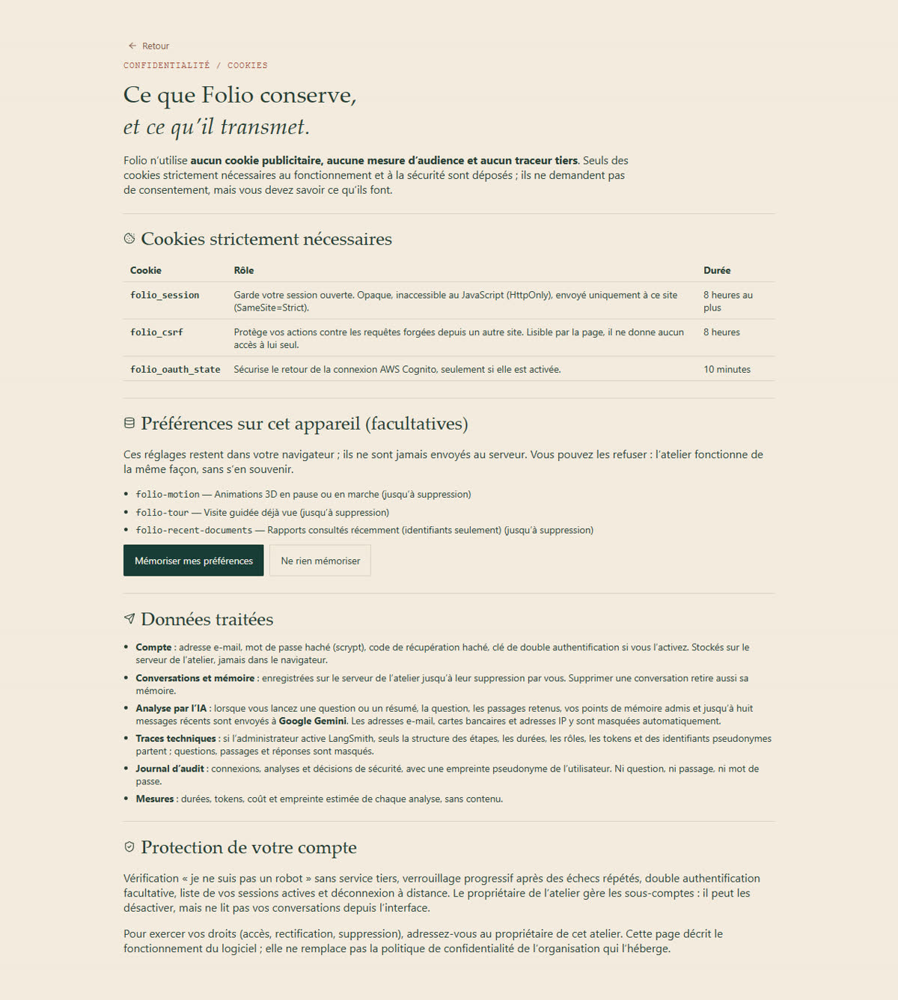 |

Ce qui change, page par page :
- **Connexion** : case « je ne suis pas un robot » (preuve de travail locale), étape de double authentification, bandeau cookies et lien vers la page Confidentialité.
- **Accueil** : visite guidée en quatre étapes au premier lancement et bloc « Folio en 10 secondes » avec les vrais chiffres du corpus.
- **Bibliothèque** : recherche par mots (« Meta 2024 »), aperçu rapide et rapports consultés récemment.
- **Chat** : chantier des agents en direct, colis scellés, passages consultés ouvrables à la page, indice d’appui, coût et empreinte, suggestions issues du corpus.
- **Résumé thématique** : chantier à quatre rôles, coût par agent, vue Audit (chaîne intacte, transferts signés), export Word, PDF et Markdown.
- **Mesures** : percentiles p50, p95 et p99, coût et empreinte par agent, latence des routes, méthode et sources.
